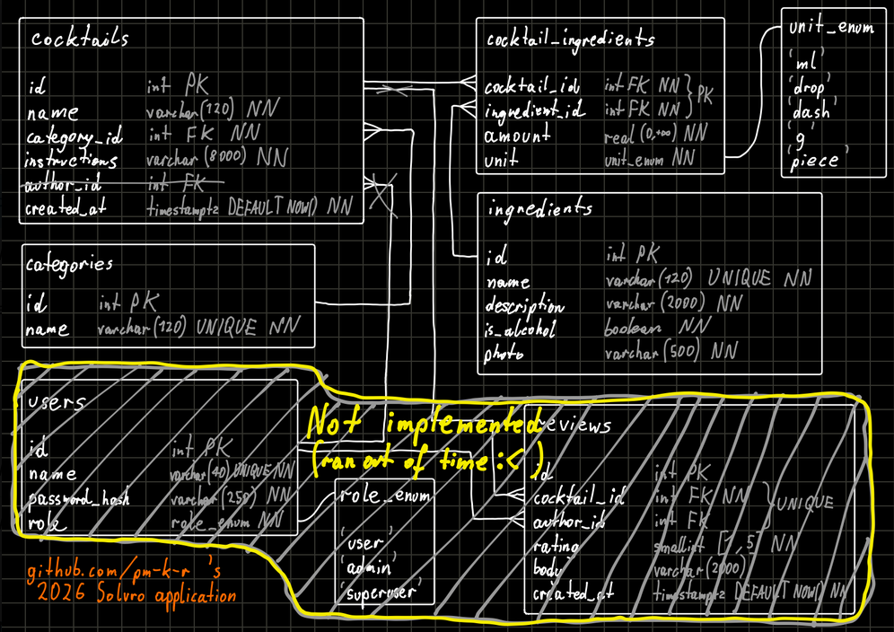
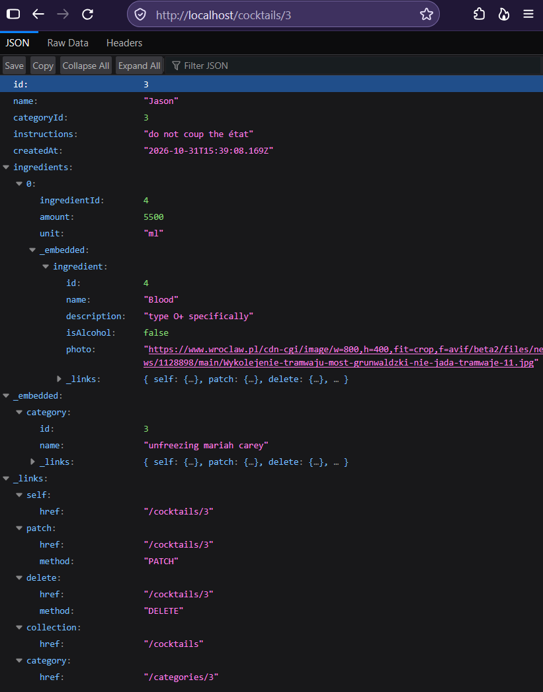

## ℹ️ About the deadline and the other branch

**Dear Solvro team,**

Welcome to the main branch of my repository.<br>
Everything in here has been committed before the deadline, apart from this README and the readme_resources directory.<br>
By extension, the database diagram was also committed late. However, I promise that I made it well before the deadline.<br>
I believe this version of the project satisfies all the basic requirements of the task (and some additional ones, see next section), apart from one tiny detail - unfortunately, I ran out of time before I could implement the endpoints for assigning ingredients to cocktails and detaching them.

This is because initially I wanted to apply to Solvro next semester, but I changed my mind within days of the deadline and had very little time to learn the framework and make the API. 😊

Thus, I have decided to create the `after-deadline` branch to fix this tiny deficiency as well as make it possible to filter cocktails by multiple ingredients at once (the deadline-adhering version of the project only allows filtering by one ingredient).<br>

## 📋 Features (in the main branch)

- ✅ All the required entities, the database gets configured correctly (to my knowledge)
- ✅ Creating, reading, updating, and deleting cocktails
- ✅ Listing cocktails with pagination (`?page=[int]&limit=[int]`) and **sorting** (`?sort=[property]`), **filtering** (`?categoryId=[id]&ingredientId=[id]&hasAlcohol=[yes|no|maybe]`), and sort order (`?order=[asc|desc]`)
- ✅ The cocktails' GET endpoints do correctly display the linked ingredients, the entity and response DTO are implemented
- ❌ Missing endpoints for assigning ingredients to cocktails and detaching them - see the `after-deadline` branch for that
- ✅ Full CRUD for ingredients (with paginated GET /ingredients)
- ✅ Full CRUD for categories
- ✅ Input validation in all requests bodies and query parameters
- ✳️ Almost fully REST compliant:
  - ✔️ The server stores no session data (statelessness)
  - ✔️ URIs represent the resources, not actions
  - ✔️ Usage of GET, POST, PATCH, and DELETE requests
  - ✔️ Manipulation through representations
  - ✔️ Self-descriptive messages (to my understanding)
  - ✔️ HATEOAS - responses are in JSON+HAL with `_links` and `_embedded` (scroll down for an example)
  - ✖️ The responses do **NOT** tell the client whether they are cacheable (I forgot) 
- ✅ Database diagram (scroll down)
- ➕ I tried to do everything as it should be done in NestJS and avoid antipatterns (I hope I succeeded)
- ➕ The code is not a total mess (hopefully)
- ➖ No users and authentication
- ➖ No automatic tests
- ➖ No generated documentation

## ⚙️ Running

Before running this project, you must set the required environment variables.<br>
Copy `.env.example`, rename to `.env`, modify the values to fit your environment and preferences.<br>
The project relies on access to a PostgreSQL database. See the next section.<br>
Running is nothing unusual:
```shell
npm install
npm run start
```

## 🐋 docker-compose.yml

For convenience, this repository includes a Docker Compose file that spins up a PostgreSQL instance.<br>
The included setup variables is compatible with the ones in `.env.example`.

## 💾 Database diagram



ℹ️ *While the database tables and columns are formatted in snake_case (PostgreSQL convention), all representations in the API are formatted in camelCase.*

## 🌳 API endpoints

- **GET /cocktails** • Query parameters: `page=[int]`, `limit=[int]`, `sort=[property]`, `order=[asc|desc]`, `categoryId=[id]`, `ingredientId=[id]`, `hasAlcohol=[yes|no|maybe]`
- **POST /cocktails**
- **GET /cocktails/\[id\]**
- **PATCH /cocktails/\[id\]**
- **DELETE /cocktails/\[id\]**
- **GET /categories**
- **POST /categories**
- **GET /categories/\[id\]**
- **PATCH /categories/\[id\]**
- **DELETE /categories/\[id\]**
- **GET /ingredients** • Query parameters: `page=[int]`, `limit=[int]`, `isAlcohol=[yes|no|maybe]`
- **POST /ingredients**
- **GET /ingredients/\[id\]**
- **PATCH /ingredients/\[id\]**
- **DELETE /ingredients/\[id\]**

### Example API response:



## 🧠 Regarding AI

100% of the code was written by me. I only used AI for assistance in research of the framework and libraries.
